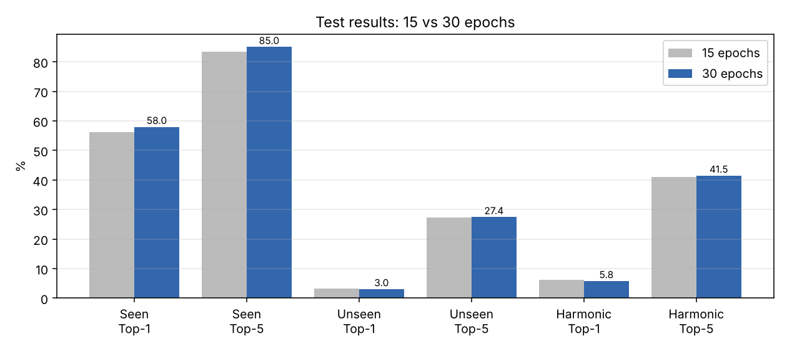
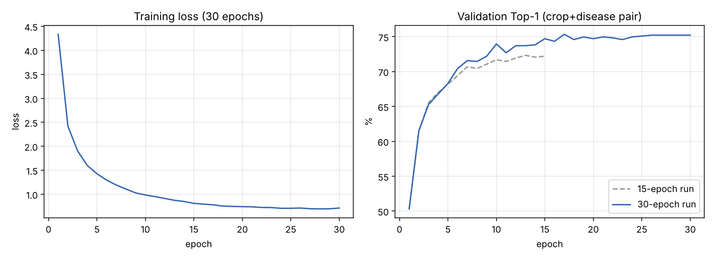

# ConvNeXt multi-task baseline: 30-epoch results

**Setup:** ConvNeXt-Tiny with ImageNet weights, backbone frozen, two linear heads (crop, disease). 30 epochs, batch 64, lr 1e-3, no fine-tuning, no class re-weighting. Run `convnext_mt_baseline_30ep`. A pair is scored as log P(crop) + log P(disease) over all 333 pairs.

## 1. Bottom line
- **Seen pairs improved a little; unseen pairs did not improve.** Doubling the epochs gives +1.7 points of seen Top-1 and no real change on unseen.
- **The baseline cannot recognise unseen pairs** (3.0% Top-1). That is the gap the proposed new approach has to close.
- **The harmonic mean is low because it is dominated by the weaker side.** With seen 57.9% and unseen 3.0%, the harmonic mean is only 5.8%.

## 2. Test results (brief section 3.3)

| Metric | 15 epochs | 30 epochs | Change |
|---|---|---|---|
| Seen Top-1 (2000 images) | 56.3% | **58.0%** | +1.7 |
| Seen Top-5 | 83.4% | **85.0%** | +1.7 |
| Unseen Top-1 (1448 images) | 3.3% | 3.0% | -0.3 |
| Unseen Top-5 | 27.2% | 27.4% | +0.2 |
| Harmonic mean Top-1 | 6.3% | 5.8% | -0.5 |
| Harmonic mean Top-5 | 41.0% | 41.5% | +0.5 |
| Seen crop accuracy | 85.6% | 87.5% | +1.9 |
| Seen disease accuracy | 58.2% | 59.4% | +1.2 |
| Unseen crop accuracy | 60.8% | 62.2% | +1.4 |
| Unseen disease accuracy | 5.5% | 5.1% | -0.4 |

## 3. Training behaviour

- Best validation pair Top-1 is **75.3%** (epoch 17, kept as `best.pt`). The 15-epoch run reached 72.3%.
- Validation stops improving after epoch 17 and stays between 74.6% and 75.2% afterwards. Extra epochs mostly fit the training set (loss 0.70 at the end).
- Training took about 1 h 50 min in total. Epochs 16 to 23 ran at roughly 290 s instead of 190 s.

## 4. Where it fails
**Unseen images: the disease head is the bottleneck.**
- Crop is right 62% of the time, but disease only 5%. The model has tied each disease to the crops it saw it on, so "early blight" on a tomato is not recognised as early blight.
- Per unseen pair (Top-1 / Top-5):

| Unseen pair | Images | Top-1 | Top-5 | Most common wrong answer |
|---|---|---|---|---|
| tomato_early_blight | 472 | 0.4% | 4.4% | tomato_late_blight |
| grape_black_rot | 271 | 0.4% | 49.4% | grape_esca |
| pepper_bell_bacterial_spot | 220 | 5.9% | 31.8% | pepper_bell_healthy |
| cotton_bacterial_blight | 125 | 10.4% | 49.6% | cotton_target_spot |
| mango_anthracnose | 95 | 3.2% | 22.1% | olive_peacock_spot |
| sugarcane_rust | 89 | 5.6% | 53.9% | sugarcane_red_rot |
| cherry_aphis_spp | 72 | 0.0% | 0.0% | apple_venturia_inaequalis |
| cucumber_powdery_mildew | 37 | 2.7% | 40.5% | tomato_powdery_mildew |
| corn_brown_spot | 35 | 0.0% | 25.7% | corn_leaf_blight |
| cucumber_downy_mildew | 32 | 18.8% | 53.1% | cucumber_downy_mildew |

- Tomato early blight alone is 33% of the unseen set and is almost never right, so it drags the overall number down. The wrong answers are usually a disease the model already knows on the same crop.

**Seen images: confusions are look-alikes** (top mistakes, true to predicted, count):
1. paddy_healthy to paddy_blast (24)
2. paddy_hispa to paddy_blast (12)
3. soybean_caterpillar to soybean_diabrotica_speciosa (11)
4. tomato_bacterial_spot to tomato_septoria_leaf_spot (11)
5. apple_healthy to apple_marssonina_blotch (10)
6. coffee_rust to coffee_healthy (10)

Full matrix: `confusion_test_seen.png` (in this folder).

## 5. Reading the numbers carefully
- This is one run with one seed. On 2000 seen images a 1.7-point change is close to the noise level (roughly 1 point), so treat it as "slightly better", not proven.
- The unseen changes (-0.3 and +0.2) are well within noise.
- Unseen accuracy is driven by two big pairs (tomato early blight, grape black rot), so the overall unseen figure is more fragile than it looks.

## 6. Which run to use as the reference baseline
Keep **30 epochs** as the reference: it has the best validation score (the checkpoint is from epoch 17) and slightly better seen results, and the unseen result is the same either way. Report the 15-epoch run as a short ablation.

## 7. What this suggests for the proposed approach
- The weakness is disease transfer across crops, not training length.
- A disease representation that does not depend on the crop (for example a separate disease embedding, or a vision-language model with text for crop and disease) targets exactly the failure above.
